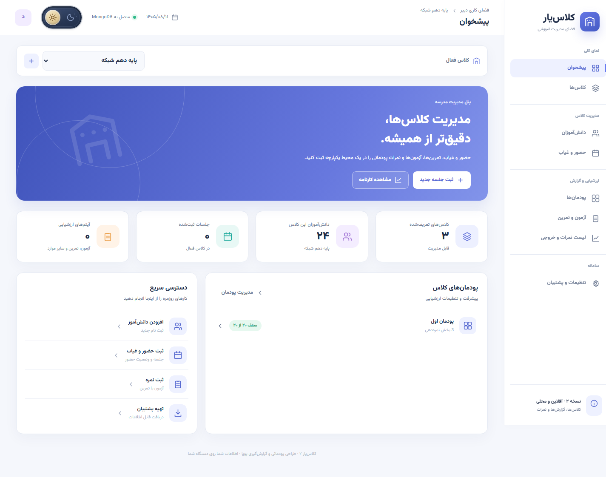
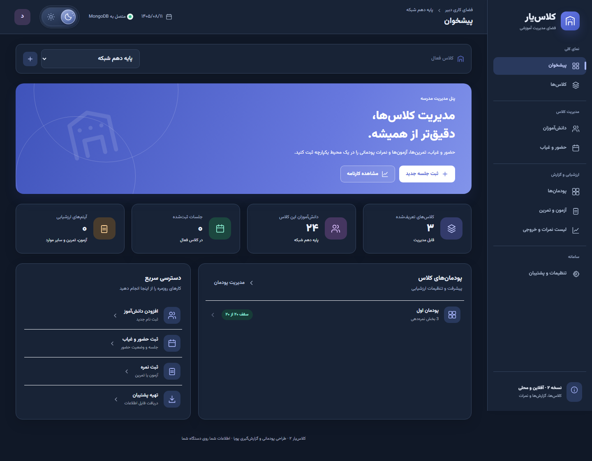

# Classyar | کلاس‌یار

**A Persian classroom manager that brings attendance, modular assessment, and grade reporting into one workspace.**

Classyar helps teachers organize classes, maintain student rosters, record attendance, and calculate grades from flexible assessment components. Its React interface is built for Persian text and right-to-left layouts, while a Node.js API stores classroom records in MongoDB.



## Highlights

- **Class and student management:** create classes by subject and academic year, edit student details, search rosters, and add students in bulk.
- **Modular assessment:** organize each class into modules, with configurable exam, exercise, project, and attendance weights.
- **Session-based attendance:** record present, absent, late, or excused status for each student and session.
- **Reliable grade calculations:** distinguish missing marks from actual zeroes and show a final grade only when the required data is complete.
- **Useful reports:** download real multi-sheet Excel workbooks, export Persian-friendly CSV files, or print landscape grade sheets.
- **MongoDB persistence:** save all eight classroom record collections together, with revision checks to prevent stale saves from overwriting newer changes.
- **Persian-first interface:** responsive RTL layouts, Persian numbers and dates, and accessible light/dark radio controls.
- **Font preferences:** choose Vazirmatn (Vazir), Iran Sans, or Parastoo. Vazirmatn and Parastoo are bundled for offline use.
- **Backup and recovery:** export and restore the complete classroom dataset as JSON.



## Technology

| Layer | Implementation |
| --- | --- |
| Interface | React with plain JavaScript; bundled runtime, no frontend build step |
| Styling | CSS, shared theme variables, responsive RTL layouts |
| Server | Node.js HTTP API |
| Database | MongoDB with the official Node.js driver |
| Reports | Browser-side XLSX and CSV generation |
| Tests | Node.js built-in test runner and real MongoDB integration tests |

## Quick start

You need **Node.js 22+**, **npm**, and a running **MongoDB** instance. Local MongoDB and MongoDB Atlas connection strings are supported.

```bash
git clone https://github.com/mohsenPourAzar/classyar-react.git
cd classyar-react
npm ci
```

Copy `.env.example` to `.env`.

**macOS / Linux**

```bash
cp .env.example .env
```

**Windows PowerShell**

```powershell
Copy-Item .env.example .env
```

The default configuration uses a local MongoDB server:

```dotenv
MONGODB_URI=mongodb://127.0.0.1:27017
MONGODB_DB=classyar
PORT=4173
```

For Atlas, put your connection string in `MONGODB_URI` and configure access in your Atlas project. Keep credentials in `.env`; it is excluded from Git.

Check the connection, then start the app:

```bash
npm run db:check
npm start
```

Open **http://127.0.0.1:4173**. There is no separate frontend build command.

On Windows, `Start_Classyar_Windows.bat` is also available. On macOS/Linux, run `sh start-linux-mac.sh`.

## A typical teaching workflow

1. Create a class and add its students individually or in bulk.
2. Create a module and configure the components that contribute to its grade.
3. Add sessions and record attendance.
4. Create exams, exercises, or projects and enter their marks.
5. Open the grade report for one module or all modules.
6. Download Excel/CSV, print the report, or export a full JSON backup.

### How grading works

Each module is graded out of **20**. Its component weights must total 20.

For an assessment component:

```text
Component contribution = (total earned marks / total possible marks) × component weight
```

For attendance, present = 1, late = 0.5, and absent = 0. Excused absences are excluded from the denominator.

A typical module uses **15 points for an exam**, **4 for exercises**, and **1 for attendance**. You can change these weights. Missing marks are kept blank; an entered zero remains zero.

## Database and persistence

The default database is `classyar`, with one `app_state` document identified by `_id: "primary"`. Its `data` field contains every classroom collection:

| Collection in the state | Records |
| --- | --- |
| `classes` | Class, grade level, subject, academic year, color |
| `students` | Student names, codes, notes, class membership |
| `modules` | Ordered modules belonging to each class |
| `components` | Grading component types and weights |
| `sessions` | Session titles, dates, and module links |
| `attendance` | Student attendance for each session |
| `assessments` | Exams, exercises, projects, and maximum marks |
| `marks` | Student marks for each assessment |

A complete snapshot is saved in one atomic document update. Each save includes the last known revision; a stale revision receives HTTP 409 instead of overwriting newer records. This storage model is intended for a single teacher and modest classroom datasets; requests are limited to 12 MB.

On first startup, an empty database is initialized from an existing `data/store.json`, if available. The original file is preserved. Otherwise, the app uses **anonymous demo records**. Existing MongoDB records are never replaced by startup seed data.

The browser keeps a local cache and pending changes. After the app has loaded, cached editing and reports can continue during a connection outage; pending changes retry when the server returns. If the server has changed in the meantime, the app keeps the local edits and offers a backup before retrieving the server version. Opening `index.html` directly uses browser storage only.

Theme and font preferences are saved per browser. Classroom records are stored in MongoDB.

### API

| Method | Endpoint | Behavior |
| --- | --- | --- |
| GET | `/api/health` | Check API and MongoDB connectivity |
| GET | `/api/state` | Read the dataset, revision, and update timestamp |
| PUT | `/api/state` | Validate and atomically save the dataset |

A PUT requires `Content-Type: application/json` and an `If-Match` header containing the quoted revision from GET, for example `If-Match: "0"`.

## Appearance

Use the header or Settings to select light or dark mode with native radio controls. Keyboard navigation, visible focus states, reduced motion, and mobile layouts are supported.

Settings also includes a font picker:

- **Vazirmatn (Vazir):** default interface font; bundled variable webfont.
- **Parastoo:** bundled regular and bold webfonts.
- **Iran Sans:** uses an installed copy or your own licensed webfonts. To enable it across devices, place `IRANSans-Regular.woff2` and `IRANSans-Bold.woff2` in `vendor/fonts/`. These proprietary font files are excluded from Git. Vazirmatn is the fallback.

The bundled fonts include their upstream license files in `vendor/fonts/`.

## Development and testing

```bash
npm test          # Grading, reports, public seed data, and state validation
npm run test:db   # Real MongoDB persistence and HTTP API integration
npm run db:check  # Check the configured database connection
npm run dev      # Start the local server
```

Integration tests create a uniquely named `classyar_test_*` database and remove only that test database afterward. They verify persistence after restart, revision conflicts, invalid data rejection, private-file exclusion, and database availability errors.

## Project structure

```text
src/          React screens, grading logic, reports, styles, appearance preferences
server/       MongoDB storage, configuration, and state validation
scripts/      Database connection check
tests/        Unit tests and MongoDB integration tests
vendor/       Bundled React runtime and open-source Persian fonts
docs/         Architecture notes and demo screenshots
server.mjs    Local HTTP server and API
.env.example  Configuration template without credentials
```

## Scope and data privacy

Classyar currently runs as a **single-teacher local application** and binds to `127.0.0.1`. It does not include account authentication, role-based access, or a multi-tenant backend. Public hosting requires those features before handling real classroom records.

The public repository includes anonymous demo data. Real classroom records, database files, local backups, environment variables, and licensed Iran Sans files are excluded from source control.

Keep regular backups using the JSON export in Settings. For implementation details, see [Architecture](docs/ARCHITECTURE.md).
