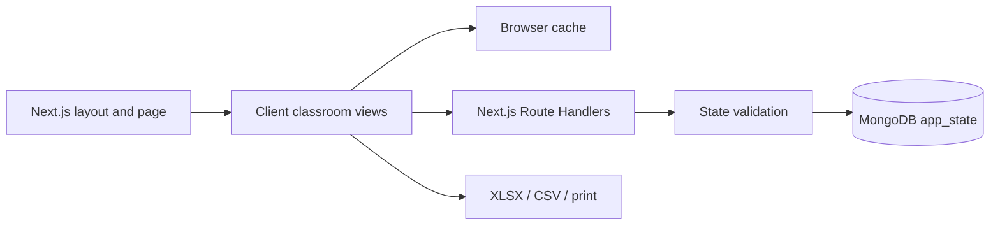

# Architecture

Classyar uses the Next.js App Router, with a Persian RTL client gradebook and server Route Handlers backed by MongoDB.

## Request flow

## Boundaries

- `src/app/` defines the root layout, application page, error screens, and API routes.
- `src/components/` contains the stateful classroom controller, feature views, forms, layout, and appearance controls.
- `src/lib/classroom/` contains pure grading/report modules and anonymous demo data.
- `src/lib/server/` contains MongoDB configuration, validation, initialization, and API functions.
- `src/styles/` contains shared CSS; `public/fonts/` contains locally served webfonts.

The gradebook initializes in a client boundary because it uses browser storage, file downloads, and local appearance settings. The document layout and metadata render through Next.js. MongoDB code is kept outside the client dependency graph, with a server-only boundary on the shared connection.

## Persistence

The `app_state` document with `_id: "primary"` stores all eight classroom collections in `data`, plus `revision` and `updatedAt`.

A save matches the expected revision and updates the data and revision atomically. Conflicting writes receive HTTP 409. This avoids partially updated related records without requiring replica-set transactions. The API accepts at most 12 MB per request.

The server reuses one MongoDB connection across requests and development hot reloads. Failed initialization clears the cached promise so a later request can reconnect.

## Database initialization

Existing MongoDB data takes precedence. An empty database imports private `data/store.json` when present, otherwise the anonymous seed. Original backup files remain private.

The root Next.js launcher loads the appropriate environment files before selecting the HTTP port. Development uses `npm run dev`; production uses `npm run build` followed by `npm start`.

## Browser synchronization

The controller reads the server snapshot and revision, stores a browser cache, and debounces edits before PUT. Writes are serialized. Pending changes survive reloads, and transient failures trigger retries.

A revision conflict retains the local state and offers JSON backup before loading current server data. The user can then reconcile or intentionally restore records.

Theme and font preferences remain local to each browser. A small script applies them before the initial page is displayed. The custom sun/moon control and bundled Persian fonts are shared across the header and Settings.

## Validation and reports

Validation checks identifiers, parent relationships, component weights, attendance states, duplicate attendance/mark pairs, and score bounds.

A final grade is produced only when required data is complete and component weights total 20. Actual zeroes remain distinct from unrecorded marks.

Report generation remains browser-side; classroom records are not sent to an external export service.

## Verification

Unit tests cover grading, exports, anonymous seed records, validation, and launcher port checks. Integration tests use an isolated real MongoDB database to verify the Route Handler service logic, atomic revisions, body limits, reconnects, and sanitized failures.

## Operational scope

The default server binds to the loopback interface. Multi-teacher or public deployment requires identity, authorization, tenant separation, auditing, and operational backups.

Private records and credentials are excluded from Git.
