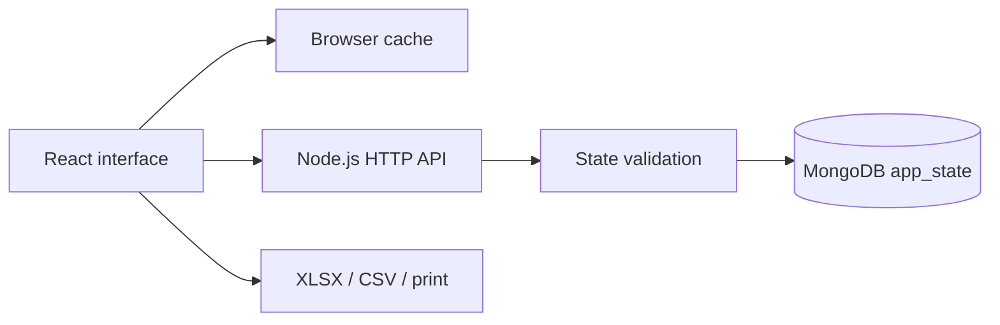

# Architecture

Classyar is a single-teacher classroom manager with a Persian RTL React interface and a local Node.js API backed by MongoDB.

## Data flow

## Classroom model

A class contains students and ordered modules. Each module contains grading components and sessions. Assessment components contain assessments; marks link students to assessments. Attendance links students to sessions.

The dataset contains `classes`, `students`, `modules`, `components`, `sessions`, `attendance`, `assessments`, and `marks`. The scoring layer in `src/logic.js` is shared by browser code and tests.

## MongoDB storage

`server/mongodb.mjs` stores the complete dataset in `app_state`, inside the `data` field of the document with `_id: "primary"`. Additional fields are `revision` and `updatedAt`.

A save matches both the identifier and the expected revision, replaces the state fields, and increments the revision in the same atomic MongoDB update. This prevents partially saved related collections and rejects conflicting writes without requiring replica-set transactions.

This snapshot model suits a modest single-teacher workload. The API accepts up to 12 MB per request. Larger or multi-tenant systems should move to separate indexed collections with transactional workflows.

## Initialization and migration

On startup, the server connects to MongoDB before accepting requests. An empty database imports `data/store.json` when present; otherwise it initializes from the anonymous public demo seed. Existing MongoDB state takes precedence and is never overwritten during initialization. The legacy JSON file remains intact.

MongoDB configuration comes from environment variables or an ignored `.env` file. The HTTP server serves only explicitly allowed frontend assets. Database configuration, legacy data, and source files in `server/` are not publicly served.

## Synchronization

The React app loads the server snapshot and its revision, keeps a browser cache, and debounces edits before PUT. A successful write advances the known revision. Pending edits are marked in browser storage, retried after transient outages, and retained across reloads.

A stale save receives HTTP 409. The app retains the local state and offers a JSON backup before loading the current server state. Users can then intentionally restore or reconcile their backup. Saving is serialized so an in-flight write cannot accidentally clear later edits.

Theme and font settings are intentionally browser-specific. The preferences bootstrap script applies them before styles render to reduce appearance flashes.

## Validation and reporting

The API checks record identifiers, required collections, parent relationships, component weights, attendance statuses, duplicate attendance/mark pairs, and numeric score bounds.

Weights may temporarily total something other than 20 while a teacher edits a module. The grading engine issues a final grade only after weights total 20 and required records are complete. Missing marks and actual zeroes remain distinct.

Excel, CSV, and print output are generated in the browser. Reports do not upload classroom data to an external export service.

## Testing

Unit tests cover grading, reports, anonymous fixtures, and state validation. Integration tests use real MongoDB in a unique temporary test database and verify API persistence across restart, conflict detection, zero marks, availability errors, and private-file exclusion.

## Current boundary

The app binds to the loopback interface and has no user authentication or role system. A multi-teacher deployment needs identity, authorization, tenant separation, audit logs, indexed entity collections, and operational backup policies.
